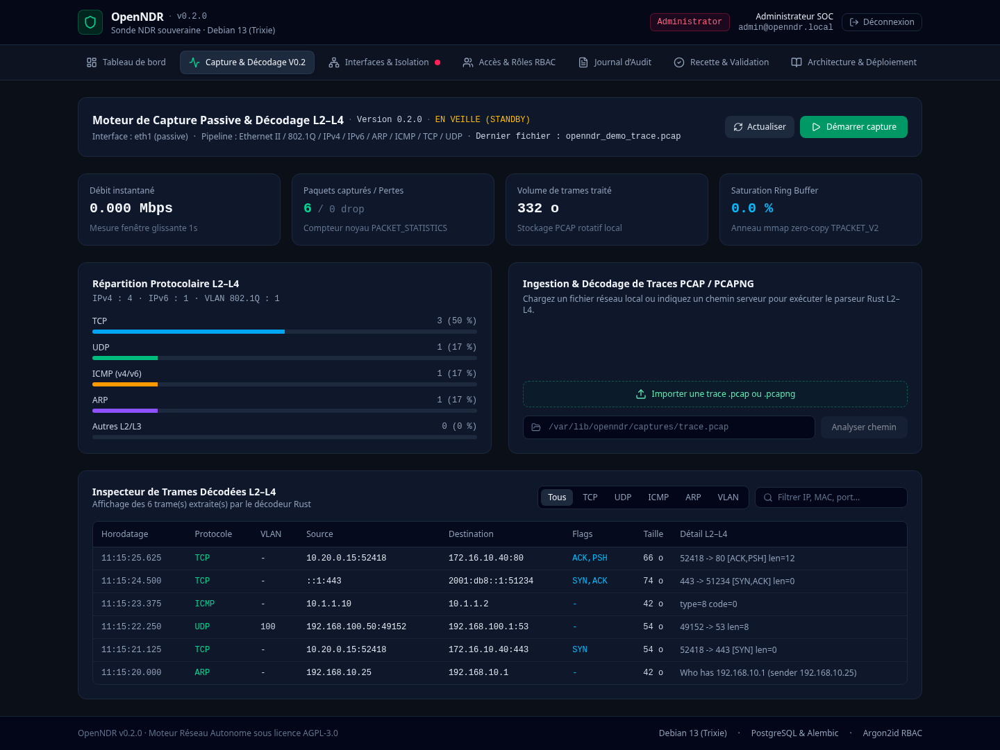
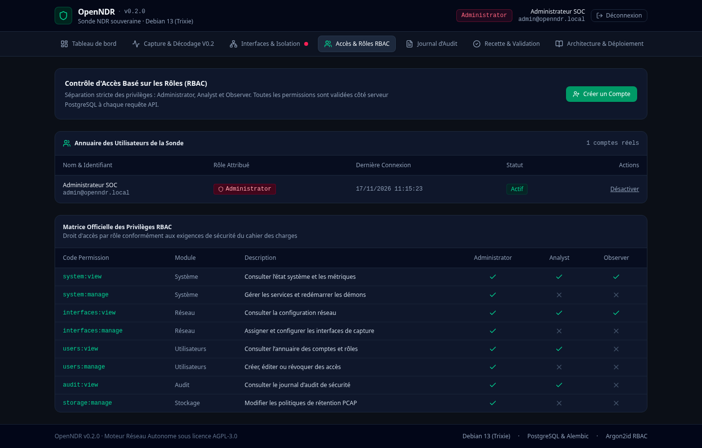
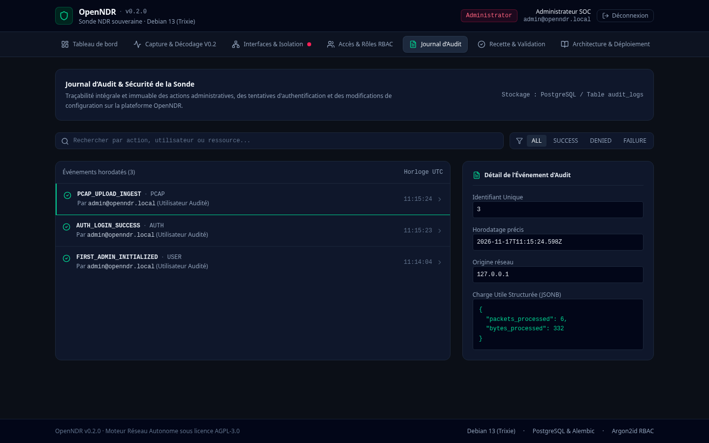
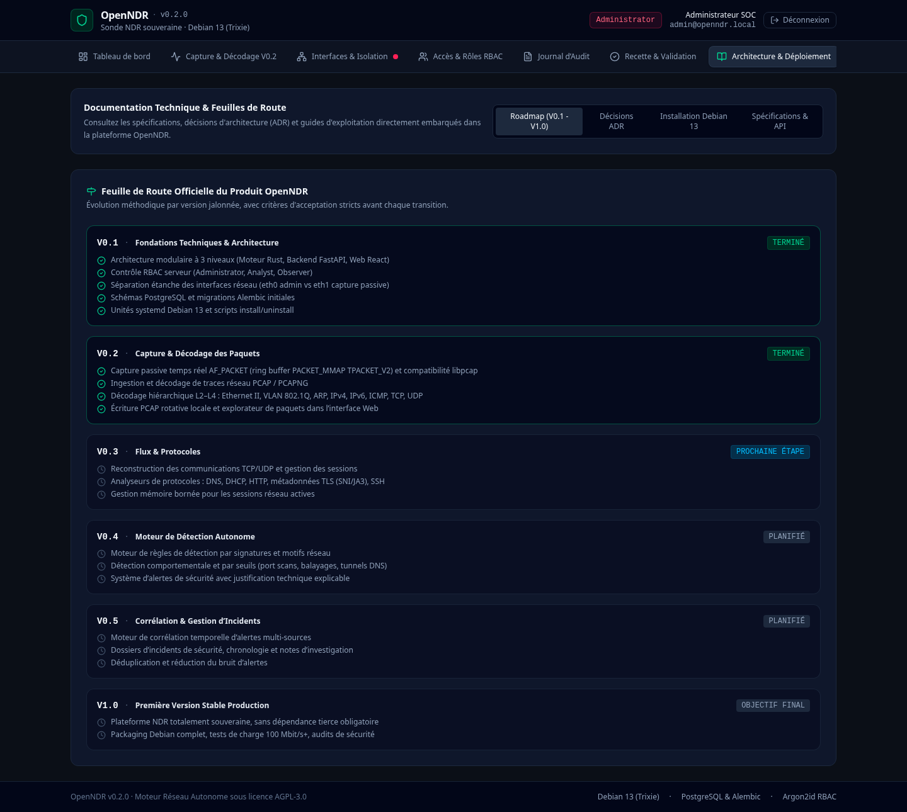

# OpenNDR — Open Source Network Detection and Response

**Dépôt officiel** : https://github.com/sheriffhomard/OpenNDROR  
**Version actuelle** : V0.2 (`0.2.0`) — Capture Passive `AF_PACKET` & Décodage Hiérarchique L2–L4  
**Licence** : AGPL-3.0  
**Système d'exploitation cible** : Debian 13 (Trixie) GNU/Linux  

---

## 1. Présentation Générale

OpenNDR est une plateforme open source souveraine de **Network Detection and Response (NDR)** autonome pour Debian 13.
Conçue pour les centres opérationnels de sécurité (SOC) et les infrastructures critiques, elle fournit une capture passive zéro-émission, un décodage protocolaire L2–L4 natif en Rust et une console d'administration durcie, sans dépendance cloud ni sonde propriétaire tierce.

> **Principe d'indépendance et d'honnêteté technique** : OpenNDR intègre ses propres composants natifs (moteur Rust `openndr-engine`, backend FastAPI, frontend React) sans dépendre de Suricata, Zeek ou Arkime, et ne simule **aucune** donnée réseau ni aucun état système.

---

## 2. Périmètre et État Réel de la Version V0.2

| Composant | État V0.2 | Description technique vérifiée |
|---|---|---|
| **Backend REST** | **Implémenté & Testé** | FastAPI, Pydantic V2, SQLAlchemy 2.0, pool PostgreSQL durci (`pytest` : 21/21 tests passés) |
| **Authentification** | **Implémenté & Testé** | Argon2id natif obligatoire en production, rejet absolu des secrets par défaut |
| **Sessions & Révocation JWT** | **Implémenté & Testé** | Claims stricts (`sub`, `iss`, `aud`, `exp`, `iat`, `jti`), révocation persistante multi-workers (`revoked_tokens`) |
| **Contrôle d'accès (RBAC)** | **Implémenté & Testé** | 3 rôles (`Administrator`, `Analyst`, `Observer`) et 8 permissions vérifiés côté serveur |
| **Bootstrap Admin & Audit** | **Implémenté & Testé** | CLI `openndr-admin create-first-admin`, journal `audit_logs` append-only (UTC, IP, JSONB) |
| **Moteur Réseau Rust (`openndr-engine`)** | **Implémenté & Testé** | Binaire natif `0.2.0` (`cargo test` : 11/11 tests passés), socket IPC `/run/openndr/engine.sock`, CLI `--check-config` / `--ingest` |
| **Capture Passive `AF_PACKET`** | **Implémenté & Testé** | Ring buffer zéro-copie `PACKET_MMAP` (`TPACKET_V2`), mode promiscuous sans IP sur l'interface SPAN |
| **Ingestion & Écriture PCAP** | **Implémenté & Testé** | Lecteur `.pcap` / `.pcapng` (`upload-pcap` & `ingest-pcap`) et écriture rotative locale (`/var/lib/openndr/captures/`) |
| **Décodeur Hiérarchique L2–L4** | **Implémenté & Testé** | Ethernet II, VLAN 802.1Q, ARP, IPv4, IPv6, ICMP (v4/v6), TCP (flags & options), UDP |
| **Console Web SOC** | **Implémenté & Testé** | React 19, TypeScript, Tailwind CSS : Tableau de bord, Capture & Décodage V0.2, Interfaces, RBAC, Audit, Sondes de recette |
| **Suivi de flux & DPI L7** | *Prévu en V0.3* | Reconstruction bidirectionnelle TCP/UDP, analyseurs DNS / HTTP / TLS (SNI, JA3/JA4) / SSH non encore implémentés |
| **Moteur de détection & Corrélation** | *Prévu en V0.4 / V0.5* | Règles par signatures, heuristiques (scan, tunnel DNS) et dossiers d'incident non encore implémentés |

---

## 3. Captures d'Écran de l'Application (OpenNDR V0.2)

Toutes les captures ci-dessous ont été réalisées directement sur l'application **OpenNDR v0.2.0** en cours d'exécution (`1440×900`) avec authentification réelle, journalisation d'audit effective et ingestion d'une trace réseau `.pcap` décodée par le binaire natif Rust `openndr-engine`.

### 3.1 Tableau de Bord de Supervision SOC

*Vue générale affichant l'état du moteur Rust (`v0.2.0`, 6 paquets décodés), le contrôle de conformité furtive (ici en alerte réelle `VIOLATION DÉTECTÉE` car l'interface de capture dispose d'une adresse IP assignée par l'environnement d'exécution), les quotas de stockage PCAP local (`0 / 500 Go`, rétention `30 jours`), l'état des 4 services (`openndr-backend`, `openndr-engine`, `postgresql`, `openndr-web`) et la séparation des interfaces (`eth2` Administration vs `eth1` Capture Passive).*

### 3.2 Capture Passive & Décodage Hiérarchique L2–L4 (V0.2)

*Console d'exploitation du moteur de capture V0.2 : télémétrie temps réel (débit en fenêtre glissante 1s, compteurs noyau `PACKET_STATISTICS` captures/pertes, volume utile traité, saturation anneau `TPACKET_V2`), répartition protocolaire L2–L4 (`TCP`, `UDP`, `ICMP`, `ARP`, compteurs `IPv4`, `IPv6`, `VLAN 802.1Q`), module d'import `.pcap` / `.pcapng` et inspecteur filtrable des trames décodées par le parser Rust (horodatage, VLAN, adresses/ports source & destination, drapeaux TCP, taille et détail L2–L4).*

### 3.3 Interfaces Réseau, Séparation Stricte & Durcissement Kernel

*Découverte dynamique des interfaces système réelles (`lo`, `eth1` en `CAPTURE_PASSIVE` promiscuous, `eth2` en `ADMINISTRATION`), vérification sans complaisance de l'absence d'adresse IP sur le port d'écoute passive et génération des commandes `sysctl` / `iproute2` d'invisibilité défensive pour Debian 13 (`arp_ignore=8`, `arp_announce=2`, `disable_ipv6=1`, `promisc on arp off`).*

### 3.4 Contrôle d'Accès RBAC & Annuaire Utilisateurs

*Gestion des comptes persistés dans PostgreSQL avec hachage Argon2id, création d'utilisateurs avec génération de mot de passe temporaire et matrice officielle des 8 permissions (`system:view`, `system:manage`, `interfaces:view`, `interfaces:manage`, `users:view`, `users:manage`, `audit:view`, `storage:manage`) réparties entre `Administrator`, `Analyst` et `Observer`.*

### 3.5 Journal d'Audit & Traçabilité Immuable

*Journal d'audit de sécurité append-only (`audit_logs`) avec recherche et filtres par statut (`ALL`, `SUCCESS`, `DENIED`, `FAILURE`), horodatage UTC précis, adresse IP d'origine et inspecteur de charge utile structurée JSONB (ex. `PCAP_UPLOAD_INGEST`, `AUTH_LOGIN_SUCCESS`, `FIRST_ADMIN_INITIALIZED`).*

### 3.6 Banc de Recette & Sondes HTTP Réelles

*Suite de 8 sondes automatisées exécutées directement contre l'API REST : disponibilité (`/api/v1/health/live`), connectivité PostgreSQL (`/api/v1/health/ready`), rapport global `v0.2.0`, rejet HTTP `401` sans jeton, rejet d'identifiants invalides avec écriture en audit, vérification réelle de l'isolation de l'interface passive (`FAIL` honnête lorsque l'IP de conteneur est présente sur `eth1`), télémétrie moteur Rust et politique de stockage PCAP local.*

### 3.7 Architecture Embarquée & Feuille de Route Produit

*Centre de documentation technique intégré à la console Web regroupant la feuille de route officielle (`V0.1` et `V0.2` marquées terminées, `V0.3` DPI/flux comme prochaine étape, `V0.4`–`V1.0` planifiées), les décisions d'architecture (ADR), le guide d'installation Debian 13 et la spécification API.*

---

## 4. Architecture Technique

```
┌────────────────────────────────────────────────────────────────────────┐
│                        RÉSEAU SOC / SUPERVISION                        │
└───────────────────────────────────┬────────────────────────────────────┘
                                    │ HTTPS (Port 443 / Reverse Proxy)
                                    ▼
┌────────────────────────────────────────────────────────────────────────┐
│  Serveur Web Nginx / Express & Frontend SPA React                      │
│  - Tableau de bord de supervision système & alertes d'isolation        │
│  - Capture & Décodage V0.2 (Télémétrie, Import PCAP, Inspecteur L2–L4) │
│  - Gestion RBAC, Journal d'audit JSONB & Sondes de validation          │
└───────────────────────────────────┬────────────────────────────────────┘
                                    │ /api/v1/ (HTTP REST)
                                    ▼
┌────────────────────────────────────────────────────────────────────────┐
│  Backend d'Orchestration FastAPI (/opt/openndr/backend)                │
│  - Authentification Argon2id & JWT avec révocation persistante         │
│  - Middleware RBAC strict (8 permissions / 3 rôles)                    │
│  - Orchestration capture & ingestion PCAP (/api/v1/system/capture/*)   │
│  - CLI d'administration : openndr-admin create-first-admin             │
└───────────────┬────────────────────────────────────────┬───────────────┘
                │ SQLAlchemy / Alembic                   │ UNIX Socket IPC + CLI
                ▼                                        ▼
┌────────────────────────────────┐      ┌────────────────────────────────┐
│ PostgreSQL 15+                 │      │ Moteur Réseau Rust V0.2        │
│ - Users, Roles, Permissions    │      │ - AF_PACKET / PACKET_MMAP      │
│ - Revoked Tokens (persistant)  │      │   (Anneau zero-copy TPACKET_V2)│
│ - Audit Logs (append-only)     │      │ - Décodeur L2–L4 (Eth/VLAN/    │
│ - Network Interfaces state     │      │   ARP/IPv4/IPv6/ICMP/TCP/UDP)  │
└────────────────────────────────┘      │ - Lecteur PCAP/PCAPNG &        │
                                        │   écriture rotative locale     │
                                        └────────────────────────────────┘
```

---

## 5. Arborescence du Projet

```text
OpenNDROR/
├── backend/                        # Backend Python / FastAPI / SQLAlchemy / Alembic
│   ├── app/
│   │   ├── api/v1/                 # Routes REST (auth, users, system + capture, health)
│   │   ├── core/                   # Configuration, base PostgreSQL, Argon2id/JWT
│   │   ├── models/                 # Modèles SQLAlchemy (User, Role, RevokedToken, AuditLog)
│   │   ├── schemas/                # Validation Pydantic V2
│   │   ├── services/               # AuthService, UserService, AuditService, SystemService
│   │   └── cli.py                  # CLI d'administration (openndr-admin)
│   ├── migrations/                 # Migrations versionnées Alembic
│   ├── tests/                      # Suite de tests pytest (21 tests dont ingestion PCAP V0.2)
│   └── pyproject.toml              # Dépendances Python et entrypoint CLI
├── engine/                         # Workspace Rust V0.2 (openndr-engine)
│   ├── crates/
│   │   ├── common/                 # Types partagés, validation d'isolation réseau
│   │   ├── capture/                # Moteur V0.2 (afpacket.rs, decoder.rs, pcap.rs, lib.rs)
│   │   └── engine/                 # Binaire openndr-engine (IPC UNIX + --check-config / --ingest)
│   └── Cargo.toml                  # Configuration du workspace Rust
├── deployment/                     # Déploiement natif Debian 13
│   ├── debian/                     # install.sh, uninstall.sh, check-prerequisites.sh, nginx
│   ├── systemd/                    # openndr-backend.service, openndr-engine.service, openndr-web.service
│   └── configuration/              # backend.env.example, openndr.conf.example
├── docs/                           # Documentation d'ingénierie et captures réelles
│   ├── screenshots/                # 7 captures d'écran actualisées de la console V0.2
│   ├── ARCHITECTURE.md             # Décisions d'architecture détaillées
│   ├── INSTALLATION_DEBIAN_13.md   # Guide complet d'installation pas-à-pas
│   ├── CONFIGURATION.md            # Guide des variables d'environnement
│   ├── SECURITY.md                 # Modèle de sécurité et divulgation
│   ├── API.md                      # Spécification des routes REST V1
│   ├── DATABASE.md                 # Dictionnaire des tables et schéma Alembic
│   ├── DEVELOPMENT.md              # Guide de contribution locale
│   ├── TESTING.md                  # Procédures de test et d'assurance qualité
│   ├── ROADMAP.md                  # Feuille de route technique V0.1 -> V1.0
│   └── TROUBLESHOOTING.md          # Résolution des anomalies opérationnelles
├── src/                            # Interface Web React 19 / TypeScript / Tailwind CSS
│   ├── components/                 # DashboardView, CaptureView, InterfacesView, RbacView,
│   │                               # AuditView, ValidationView, DocsView, LoginModal, Header
│   ├── App.tsx                     # Contrôleur principal de la console SOC
│   └── types.ts                    # Contrats TypeScript alignés sur l'API REST V1
├── server.ts                       # Serveur Express / Vite intégré (port 3000) & pont moteur Rust
├── index.html                      # Point d'entrée SPA
├── package.json                    # Dépendances Node.js / React et scripts tsx/vite
├── vite.config.ts                  # Configuration Vite
└── .github/workflows/ci.yml        # Pipeline CI GitHub Actions (Rust, Python, Frontend)
```

---

## 6. Guide de Déploiement Rapide (Debian 13) & Tests

### 6.1 Prérequis
- Debian 13 (Trixie) `x86_64`
- 2 cœurs CPU minimum (4+ recommandés)
- 4 Go de mémoire RAM minimum (8+ Go recommandés)
- 2 interfaces réseau physiques (ex. `eth0` pour administration IP, `eth1` pour écoute passive sans IP)
- Paquets système de compilation et capture : `build-essential`, `libpcap-dev`, `rustc`/`cargo`, `postgresql`, `nginx` (installés automatiquement par `install.sh`)

### 6.2 Installation Automatique sur Debian 13
```bash
git clone https://github.com/sheriffhomard/OpenNDROR.git /opt/openndr
cd /opt/openndr
sudo bash deployment/debian/install.sh
```

### 6.3 Initialisation Obligatoire du Premier Administrateur
```bash
# La plateforme refuse tout démarrage avec des comptes par défaut
openndr-admin create-first-admin --email admin@votre-domaine.local --full-name "Admin SOC"
```

### 6.4 Démarrage des Services & Vérification
```bash
sudo systemctl start openndr-backend
sudo systemctl start openndr-engine

curl -s http://127.0.0.1:8000/api/v1/health | jq .
curl -s http://127.0.0.1:8000/api/v1/health/ready | jq .
```

### 6.5 Exécution Locale & Suite de Tests Automatisés
```bash
# 1. Tests unitaires du moteur Rust (AF_PACKET, lecteur PCAP, décodeur L2–L4)
cargo test --manifest-path engine/Cargo.toml
cargo build --release --manifest-path engine/Cargo.toml

# 2. Tests d'intégration et sécurité du backend FastAPI
PYTHONPATH=backend pytest backend/tests -v

# 3. Console Web & serveur de développement (port 3000)
npm install && npm run dev
```

---

## 7. Prochaines Étapes : Préparation V0.3

La version **V0.3** permettra de passer de l'analyse par paquet à la compréhension des sessions applicatives :
1. Suivi d'état bidirectionnel des flux TCP et UDP (table de flux à mémoire bornée anti-DoS).
2. Analyseurs protocolaires applicatifs autonomes (DPI) : DNS, HTTP/1.1, TLS (extraction SNI et empreintes JA3/JA4) et SSH.
3. Exposition des métriques de sessions et métadonnées protocolaires dans l'API REST et la console SOC.
