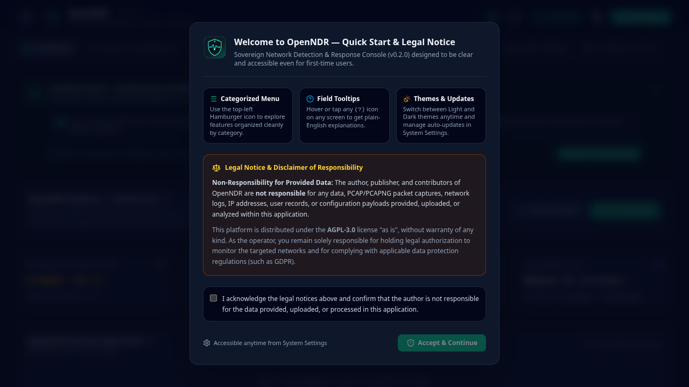
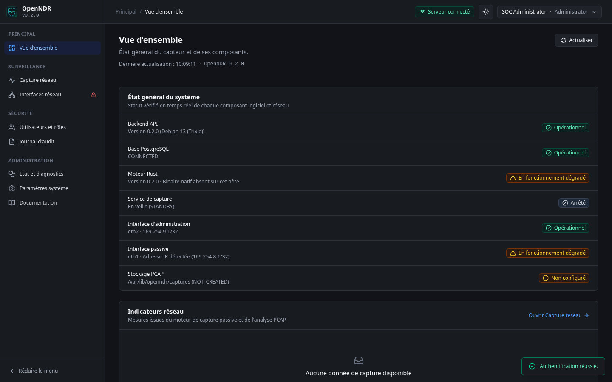
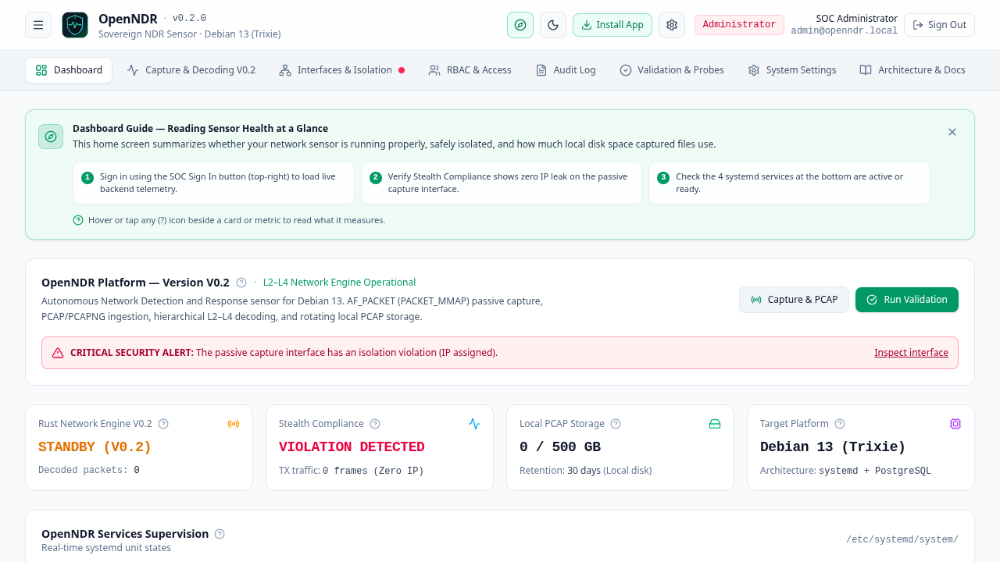
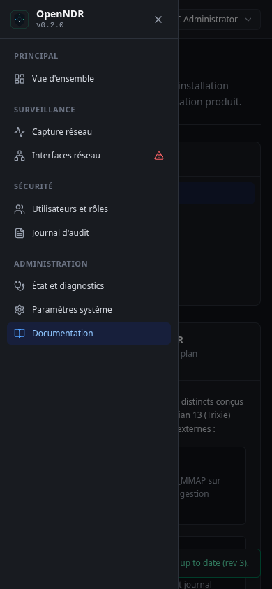
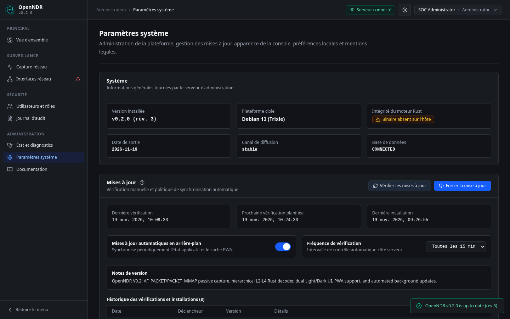
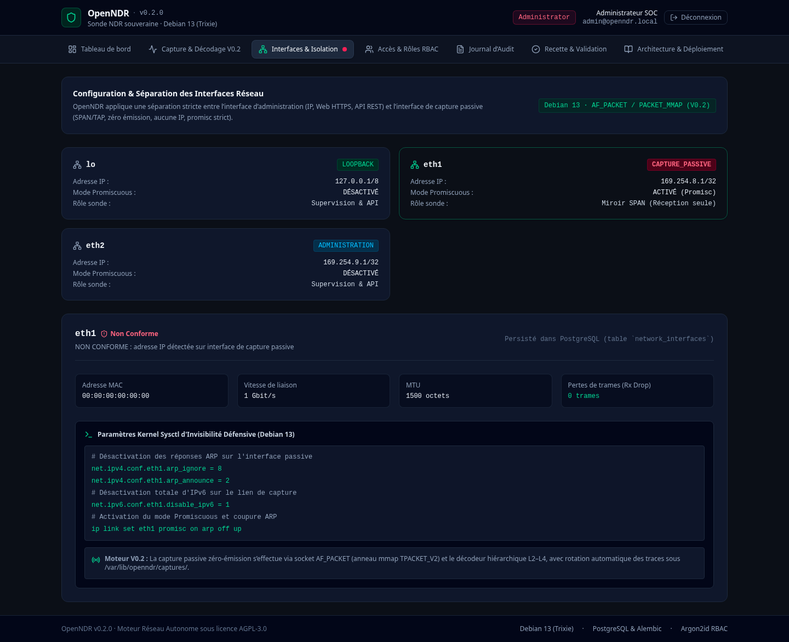
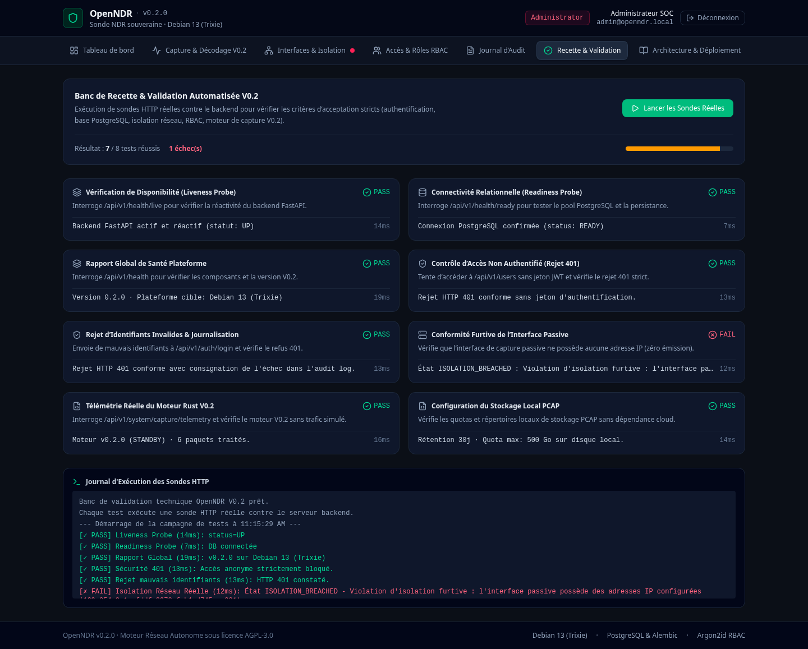

<div align="center">
  
  <h1>OpenNDR — Open Source Network Detection and Response</h1>
  <p><strong>Plateforme NDR souveraine autonome pour Debian 13 · Capture Passive <code>AF_PACKET</code> · Décodage L2–L4 · Console PWA Clair/Sombre</strong></p>

  -10b981?style=flat-square)
  -0f172a?style=flat-square&logo=debian&logoColor=white)
  
  
  
  
</div>

---

- 🌐 **Dépôt officiel** : https://github.com/sheriffhomard/OpenNDROR
- 🚀 **Version actuelle** : V0.2 (`0.2.0`) — Capture Passive `AF_PACKET`, Décodage L2–L4, Console unifiée sobre Clair/Sombre & PWA
- ⚖️ **Licence** : AGPL-3.0
- 🐧 **Système d'exploitation cible** : Debian 13 (Trixie) GNU/Linux
- 📚 **Documents connexes** : [`CONTEXT.md`](CONTEXT.md) · [`CHANGELOG.md`](CHANGELOG.md) · [`docs/ROADMAP.md`](docs/ROADMAP.md) · [`docs/SECURITY.md`](docs/SECURITY.md)

---

## 🧭 1. Présentation Générale

**OpenNDR** est une plateforme open source souveraine de **Network Detection and Response (NDR)** autonome pour Debian 13. Conçue pour une exploitation quotidienne en production, elle associe une capture passive zéro-émission, un décodage protocolaire L2–L4 natif en Rust et une console d'administration web sobre et cohérente en thèmes **Clair** et **Sombre**.

> 🛡️ **Principe d'indépendance et d'honnêteté technique** : OpenNDR intègre ses propres composants natifs (moteur Rust `openndr-engine`, backend FastAPI, frontend React/PWA) sans dépendre de Suricata, Zeek ou Arkime, et n'affiche **aucune** donnée fictive, simulée ou estimée. En cas d'indisponibilité ou d'absence de configuration, l'interface indique explicitement l'état réel (`Indisponible`, `Non configuré`, `Aucune donnée de capture disponible`).
>
> ⚖️ **Mention légale de non-responsabilité** : L'auteur et les contributeurs d'OpenNDR ne sont pas responsables des données (traces PCAP/PCAPNG, adresses IP, journaux, comptes ou charges utiles) fournies, téléversées ou analysées dans l'application. Une modale d'acceptation légale s'affiche au premier lancement.

---

## ⚙️ 2. Périmètre et Nouveautés de la Version V0.2

| Icône | Composant | État V0.2 | Description technique vérifiée |
| :---: |---|---|---|
| ⚡ | **Backend REST** | **Implémenté & Testé** | FastAPI, Pydantic V2, SQLAlchemy 2.0, pool PostgreSQL durci + routes `/api/v1/system/updates*` |
| 🔐 | **Authentification** | **Implémenté & Testé** | Argon2id natif obligatoire en production, rejet absolu des secrets par défaut |
| 🪪 | **Sessions & Révocation JWT** | **Implémenté & Testé** | Claims stricts (`sub`, `iss`, `aud`, `exp`, `iat`, `jti`), révocation persistante multi-workers (`revoked_tokens`) |
| 👥 | **Contrôle d'accès (RBAC)** | **Implémenté & Testé** | 3 rôles (`Administrator`, `Analyst`, `Observer`) et 8 permissions vérifiés côté serveur et filtrés dans le menu |
| 📝 | **Bootstrap Admin & Audit** | **Implémenté & Testé** | CLI `openndr-admin create-first-admin`, journal `audit_logs` append-only (UTC, IP, JSONB) |
| 🦀 | **Moteur Réseau Rust (`openndr-engine`)** | **Implémenté & Testé** | Binaire natif `0.2.0`, socket IPC `/run/openndr/engine.sock`, CLI `--check-config` / `--ingest` |
| 📡 | **Capture Passive `AF_PACKET`** | **Implémenté & Testé** | Ring buffer zéro-copie `PACKET_MMAP` (`TPACKET_V2`), mode promiscuous sans IP sur l'interface SPAN |
| 📦 | **Ingestion & Écriture PCAP** | **Implémenté & Testé** | Lecteur `.pcap` / `.pcapng` (`upload-pcap` & `ingest-pcap`) et écriture rotative locale (`/var/lib/openndr/captures/`) |
| 🔬 | **Décodeur Hiérarchique L2–L4** | **Implémenté & Testé** | Ethernet II, VLAN 802.1Q, ARP, IPv4, IPv6, ICMP (v4/v6), TCP (flags & options), UDP |
| 🗂️ | **Navigation Unifiée (Sidebar)** | **Implémenté & Vérifié** | Barre latérale unique persistante et rétractable (4 groupes : *Principal*, *Surveillance*, *Sécurité*, *Administration*) + tiroir mobile |
| 🔄 | **Paramètres & Auto-Updater** | **Implémenté & Vérifié** | 5 catégories (*Système*, *Mises à jour*, *Affichage*, *Préférences utilisateur*, *Informations légales*) et planificateur automatique |
| ☀️ | **Thème Clair & Sombre Sobres** | **Implémenté & Vérifié** | Palette classique d'administration système (clair `#f3f4f6` / `#ffffff`, sombre `#111318` / `#181b20`) sans flash au chargement |
| 📱 | **Logo & Bouton Installer l'app (PWA)** | **Implémenté & Vérifié** | Logo officiel SVG/PNG, manifeste Web App, Service Worker `autoUpdate` et bouton d'installation dans les préférences |
| 🔍 | **Suivi de flux & DPI L7** | *Prévu en V0.3* | Reconstruction bidirectionnelle TCP/UDP, analyseurs DNS / HTTP / TLS (SNI, JA3/JA4) / SSH |
| 🚨 | **Détection & Corrélation** | *Prévu en V0.4 / V0.5* | Règles par signatures, heuristiques (scan, tunnel DNS) et dossiers d'incident |

---

## 📸 3. Captures d'Écran de l'Application (Console Refondue)

Toutes les captures ci-dessous ont été réalisées en conditions réelles (`1440×900` bureau et `390×844` mobile) sur la console unifiée **OpenNDR** avec états réels du serveur, sans aucune donnée fictive.

### 3.1 Onboarding Légal & Clause de Non-Responsabilité

*Fenêtre d'accueil au premier lancement présentant les **mentions légales explicites** indiquant que l'auteur n'est pas responsable des données fournies, importées ou analysées dans l'application.*

### 3.2 Vue d'Ensemble — Thème Sombre

*Console principale avec barre latérale unique (*Principal*, *Surveillance*, *Sécurité*, *Administration*), barre supérieure épurée (fil d'Ariane, état réel de connexion au serveur, sélecteur de thème, menu utilisateur) et états vérifiés des composants système.*

### 3.3 Vue d'Ensemble — Thème Clair

*Thème **Clair** sobre conçu pour une utilisation prolongée sur poste de travail.*

### 3.4 Navigation Mobile Responsive

*Sur tablette et mobile (`390×844`), la barre latérale se transforme automatiquement en tiroir accessible se refermant à la sélection ou avec `Échap`.*

### 3.5 Paramètres Système, Mises à Jour & Préférences

*Écran **Paramètres système** organisé en 5 catégories (*Système*, *Mises à jour*, *Affichage*, *Préférences utilisateur*, *Informations légales*), sans valeurs de repli codées en dur.*

### 3.6 Capture Réseau & Analyse PCAP

*Pilotage du moteur de capture, import `.pcap`/`.pcapng`, état explicite « Aucune donnée de capture disponible » en l'absence de trafic traité et confirmation avant arrêt de capture.*

### 3.7 Interfaces Réseau & Vérification d'Isolation

*Découverte dynamique des interfaces réelles de l'hôte, séparation entre interface d'administration et port de capture passive, et signalement exact d'une non-conformité si une adresse IP est présente.*

### 3.8 Utilisateurs, Rôles & Matrice RBAC

*Annuaire réel des comptes, création avec mot de passe temporaire affiché une seule fois, confirmation avant révocation et matrice de référence des 8 permissions.*

### 3.9 Journal d'Audit & Inspecteur JSON

*Tableau chronologique (*Date*, *Utilisateur*, *Action*, *Résultat*, *Adresse IP*, *Détails*) et inspecteur détaillé.*

### 3.10 État et Diagnostics

*Exécution à la demande de vérifications HTTP distinguant clairement joignabilité API, connectivité base de données, présence réelle du binaire Rust et conformité réseau.*

### 3.11 Documentation Embarquée

*Référentiels d'architecture, ADR, procédure Debian 13, contrats `/api/v1` et feuille de route produit indicative.*

---

## 🏗️ 4. Architecture Technique

```text
┌────────────────────────────────────────────────────────────────────────┐
│              NAVIGATEUR SOC / APPLICATION PWA INSTALLÉE                │
└───────────────────────────────────┬────────────────────────────────────┘
                                    │ HTTPS (Port 443 / Reverse Proxy)
                                    ▼
┌────────────────────────────────────────────────────────────────────────┐
│  Serveur Web Nginx (prod: /opt/openndr/dist) / Vite (dev) + PWA        │
│  - Navigation unifiée par Sidebar persistante + tiroir mobile          │
│  - TopBar épurée (fil d'Ariane, connexion API, thème, session)         │
│  - Thèmes Clair / Sombre sobres, composants UI uniformisés             │
│  - Capture V0.2, Interfaces, RBAC, Audit JSONB & Diagnostics réels     │
└───────────────────────────────────┬────────────────────────────────────┘
                                    │ /api/v1/ (HTTP REST)
                                    ▼
┌────────────────────────────────────────────────────────────────────────┐
│  Backend d'Orchestration FastAPI (/opt/openndr/backend)                │
│  - Authentification Argon2id & JWT avec révocation persistante         │
│  - Middleware RBAC strict (8 permissions / 3 rôles)                    │
│  - Orchestration capture, PCAP & mises à jour (/api/v1/system/*)       │
│  - CLI d'administration : openndr-admin create-first-admin             │
└───────────────┬────────────────────────────────────────┬───────────────┘
                │ SQLAlchemy / Alembic                   │ UNIX Socket IPC + CLI
                ▼                                        ▼
┌────────────────────────────────┐      ┌────────────────────────────────┐
│ PostgreSQL 15+                 │      │ Moteur Réseau Rust V0.2        │
│ - Users, Roles, Permissions    │      │ - AF_PACKET / PACKET_MMAP      │
│ - Revoked Tokens (persistant)  │      │   (Anneau zero-copy TPACKET_V2)│
│ - Audit Logs (append-only)     │      │ - Décodeur L2–L4 (Eth/VLAN/    │
│ - System Settings & Interfaces │      │   ARP/IPv4/IPv6/ICMP/TCP/UDP)  │
└────────────────────────────────┘      │ - Lecteur PCAP/PCAPNG &        │
                                        │   écriture rotative locale     │
                                        └────────────────────────────────┘
```

---

## 📂 5. Arborescence du Projet

```text
OpenNDROR/
├── backend/                        # Backend Python / FastAPI / SQLAlchemy / Alembic
│   ├── app/
│   │   ├── api/v1/                 # Routes REST (auth, users, system + capture, health)
│   │   ├── core/                   # Configuration, base PostgreSQL, Argon2id/JWT
│   │   ├── models/                 # Modèles SQLAlchemy (User, Role, RevokedToken, AuditLog)
│   │   ├── schemas/                # Validation Pydantic V2
│   │   ├── services/               # AuthService, UserService, AuditService, SystemService
│   │   └── cli.py                  # CLI d'administration (openndr-admin)
│   ├── migrations/                 # Migrations versionnées Alembic
│   ├── tests/                      # Suite de tests pytest
│   └── pyproject.toml              # Dépendances Python et entrypoint CLI
├── engine/                         # Workspace Rust V0.2 (openndr-engine)
│   ├── crates/
│   │   ├── common/                 # Types partagés, validation d'isolation réseau
│   │   ├── capture/                # Moteur V0.2 (afpacket.rs, decoder.rs, pcap.rs, lib.rs)
│   │   └── engine/                 # Binaire openndr-engine (IPC UNIX + --check-config / --ingest)
│   └── Cargo.toml                  # Configuration du workspace Rust
├── deployment/                     # Déploiement natif Debian 13
│   ├── debian/                     # install.sh, uninstall.sh, check-prerequisites.sh, nginx-openndr.conf
│   ├── systemd/                    # openndr-backend.service, openndr-engine.service
│   └── configuration/              # backend.env.template, openndr.conf.template
├── docs/                           # Documentation d'ingénierie et 11 captures réelles
│   ├── screenshots/                # Captures 01 à 11 actualisées (Clair/Sombre/Mobile/Diagnostics)
│   └── *.md                        # ARCHITECTURE, INSTALLATION_DEBIAN_13, SECURITY, API, ROADMAP...
├── public/                         # Logo officiel, theme-init.js & icônes PWA
├── scripts/                        # verify-frontend.mjs, test-anti-mock.mjs & verify-ui.mts
├── src/                            # Interface Web React 19 / TypeScript / Tailwind CSS v4
│   ├── config/navigation.ts        # Définition centralisée des sections et permissions RBAC
│   ├── components/
│   │   ├── ui/                     # PageHeader, SectionCard, StatusBadge, StateBlocks, DataTable, ConfirmDialog
│   │   ├── Sidebar.tsx & TopBar.tsx# Navigation latérale unique + barre supérieure épurée
│   │   ├── DashboardView.tsx       # Vue d'ensemble et guide de première utilisation réel
│   │   ├── CaptureView.tsx         # Capture passive, import PCAP et exploration paquets
│   │   ├── InterfacesView.tsx      # Interfaces d'administration / passive et durcissement sysctl
│   │   ├── RbacView.tsx            # Utilisateurs, rôles et matrice des permissions
│   │   ├── AuditView.tsx           # Journal d'audit et inspecteur JSON
│   │   ├── ValidationView.tsx      # État et diagnostics techniques
│   │   ├── SystemSettingsView.tsx  # Paramètres système en 5 catégories
│   │   └── DocsView.tsx            # Documentation et feuille de route indicative
│   ├── hooks/                      # useTheme.ts, usePWAInstall.ts
│   ├── services/                   # api.ts (client REST typé)
│   ├── types/                      # system.ts (contrats API & états)
│   └── App.tsx                     # Contrôleur principal, gestion connexion backend & RBAC
├── CONTEXT.md                      # Document de contexte produit & architecture
├── CHANGELOG.md                    # Historique des versions (V0.1.0 & V0.2.0)
├── vite.config.ts                  # Configuration Vite + proxy VITE_API_PROXY_TARGET + VitePWA
└── .github/workflows/ci.yml        # Pipeline CI GitHub Actions (Rust, Python, Frontend)
```

---

## 🚀 6. Guide de Déploiement Rapide (Debian 13) & Tests

### 6.1 Prérequis
- Debian 13 (Trixie) `x86_64`
- 2 cœurs CPU minimum (4+ recommandés), 4 Go RAM minimum (8+ Go recommandés)
- 2 interfaces réseau physiques (administration IP + capture passive sans IP)

### 6.2 Installation Automatique sur Debian 13
```bash
git clone https://github.com/sheriffhomard/OpenNDROR.git /opt/openndr
cd /opt/openndr
sudo bash deployment/debian/install.sh
```

### 6.3 Initialisation Obligatoire du Premier Administrateur
```bash
openndr-admin create-first-admin --email admin@votre-domaine.local --full-name "Admin SOC"
```

### 6.4 Démarrage des Services & Exécution des Tests
```bash
# Tests unitaires moteur Rust V0.2
cargo test --manifest-path engine/Cargo.toml
cargo build --release --manifest-path engine/Cargo.toml

# Tests backend FastAPI
PYTHONPATH=backend pytest backend/tests -v

# Console Web & serveur de développement Vite (port 3000) avec proxy vers FastAPI
VITE_API_PROXY_TARGET="http://127.0.0.1:8001" npm install && npm test && VITE_API_PROXY_TARGET="http://127.0.0.1:8001" npm run dev
```

---

## 🗺️ 7. Prochaines Étapes : Préparation V0.3

La version **V0.3** permettra de passer de l'analyse par paquet à la compréhension des sessions applicatives :
1. Suivi d'état bidirectionnel des flux TCP et UDP (table de flux à mémoire bornée anti-DoS).
2. Analyseurs protocolaires applicatifs autonomes (DPI) : DNS, HTTP/1.1, TLS (extraction SNI et empreintes JA3/JA4) et SSH.
3. Exposition des métriques de sessions et métadonnées protocolaires dans l'API REST et la console SOC.
